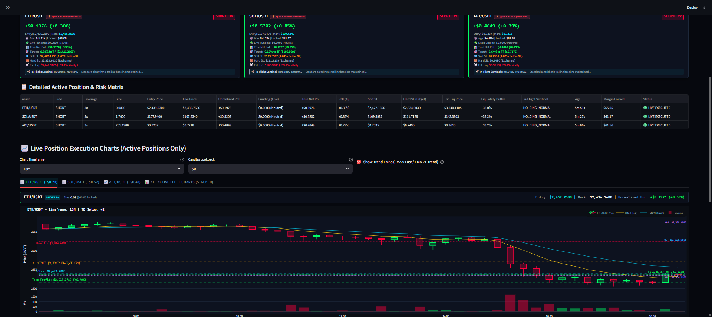
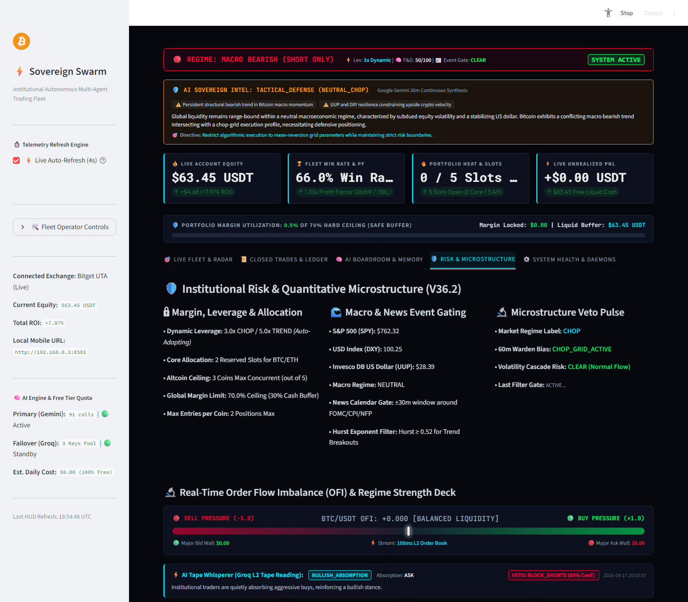
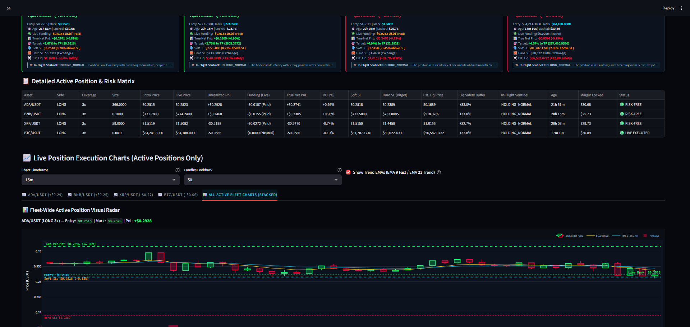
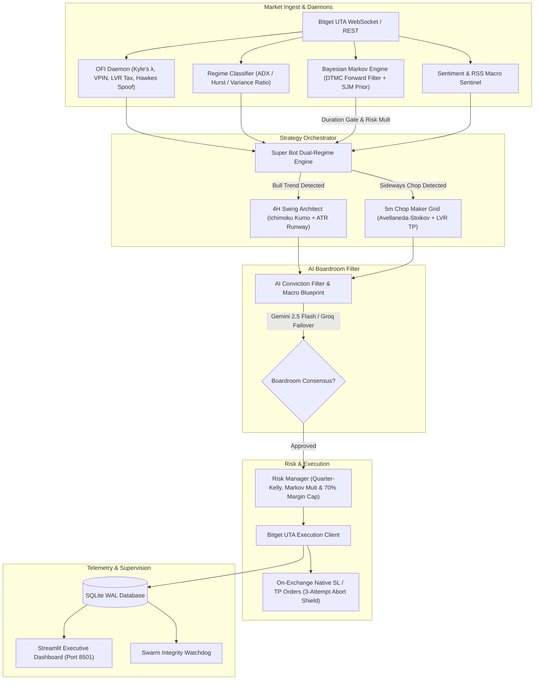

# 🦅 Autonomous Multi-Agent Crypto Trading Engine

[](https://www.python.org/)
[](https://opensource.org/licenses/MIT)
[](https://streamlit.io/)
[](https://www.bitget.com/)

A production-grade, multi-asset crypto futures trading system featuring a **Dual-Regime Execution Engine** (4H Trend Swing & 5m Chop Maker Grid), high-frequency **Order Flow Imbalance (OFI)** microstructure filtering, a **Bayesian Markov Regime & Transition Engine (DTMC)** with Jump-Model persistence, and an autonomous **Multi-Agent AI Risk Boardroom** with real-time LLM failover.

---

## ⚡ Key Highlights

- **Dual-Regime Execution Architecture**:
  - **4H Bull Trend Swing**: Trend-following breakout strategy using custom Ichimoku Kumo bands, volatility expansion, and dynamic trailing stop-loss ratchets.
  - **5m Chop Maker Grid**: Low-latency, post-only limit order grid designed to capture mean-reverting chop while earning maker fee rebates.
  - **Avellaneda–Stoikov Reservation Pricing**: Inventory-skewed limit placement $r(s, q) = s - q\gamma\sigma^2$ with LVR-compensated take-profit geometry.
- **Bayesian Markov Regime & Transition Engine (DTMC)**:
  - Online Discrete-Time Markov Chain with **Forward Bayesian Filtering**, Laplace smoothing, and Statistical Jump Model (SJM) diagonal persistence regularization ($\lambda=3.0$).
  - **Tradability Duration Gate**: Computes expected duration $E[D_i] = \frac{1}{1 - P_{ii}}$ and blocks execution if $E[D] < 3.5$ bars, eliminating whipsaw fee churn during micro-regimes.
  - **Empirical Moment Ordering Invariant**: Enforces $\mu(\text{Bear}) \le \mu(\text{Chop}) \le \mu(\text{Bull})$ to guarantee zero silent state permutations across rolling refits.
  - **Continuous Risk Multiplier**: Dynamically scales position sizing $[0.20\times, 1.0\times]$ as a linear expectation of the posterior belief vector $\pi_t$.
- **High-Frequency Microstructure & Adverse Selection Shield**:
  - **Multi-Level Order Flow Imbalance (MLOFI)**: 10-level geometric decay depth tracking across real-time Bitget order books.
  - **Kyle's $\lambda$ & Adverse Selection Impact**: Continuous covariance-to-volume ratio measuring informed toxic flow, rolling percentiles, and automatic pre-trade toxicity halts.
  - **Loss-Versus-Rebalancing (LVR) Volatility Tax**: Continuous arbitrage drag calculation ($\sigma^2/8$) embedded into take-profit targets.
  - **Hawkes Process LOB Anti-Spoof Guard**: Self-exciting point process tracking order cancellation clusters and spectral radius ($\rho \ge 1.0$) cascades.
- **Causal Quantitative Indicator Pipeline**:
  - Causality, stated with its limits: the live indicator path (`indicators.py`) is covered by a truncation-invariance test (`tests/test_indicators.py:50` recomputes EMA20/EMA50/RSI14/ATR14 on `df[:t+1]` and asserts they equal row `t` from the full history), so on that path `row t` strictly depends on closes $\le t$. The historical backtest corpus was not originally clean — it had intrabar trailing-stop and higher-timeframe resample lookahead, fixed on this branch, and results generated before that fix were favourable by that margin.
  - Strict OHLCV integrity validation and cold-start warm-up verification (`WARMUP_BARS = 600`, `indicators.py:19`, required before trusting long-memory indicators such as EMA200).
  - Causal Tom DeMark Setup engine (`td_setup_counts`) requiring price-flip initiation and completing cleanly at TD-9 without indefinite rollover.
  - Confirmed $k$-bar fractal momentum divergence (RSI & MACD histogram) with strict bar separation and ATR-normalized displacement to prevent pivot repainting.
  - Prior-bar Volume Profile (VPVR: POC, VAH, VAL) calculation avoiding in-flight candle lookahead leaks.
- **Multi-Agent AI Boardroom**:
  - Consensus filtering using primary LLM reasoning (Gemini Flash) with automatic zero-downtime failover to high-throughput secondary pools (Groq / Llama-3).
  - In-flight position monitoring, early structural invalidation, and automated post-mortem trade analysis.
- **Institutional Risk Controls**:
  - Global portfolio margin utilization ceiling (hard cap at 70%).
  - Hard stops placed directly on-exchange upon fill to prevent liquidation during network outages or loop stalls.
  - High-water mark (HWM) drawdown tracked and displayed, but **no drawdown breaker is wired to execution on this branch**. The dashboard derives `hwm` and `drawdown` from the cumulative realized PnL purely to plot its equity-drawdown chart (`dashboard.py:2571-2572`, trace at `:2598`); the stored `hwm_balance` key is read live only as a capital fallback for the Monte Carlo's initial equity (`quant_validation.py:629`, applied at `:635`) and is written only by `archive/legacy_agents/state_manager.py:165-181`, which computes the figure and never halts on it. The two percentage-drawdown constants in `config.py` (`:292-293`, `PER_SYMBOL_DD_LIMIT`, `PROGRESSIVE_SCALING_THRESHOLD`) have no consumer anywhere in the codebase. What does stop re-entry is the post-loss anti-whipsaw cooldown, which keys on elapsed time since a loss, not on a drawdown level (`swing_trader.py:217`, `:295`).
- **Real-Time Streamlit HUD (Port 8501)**:
  - Complete situational awareness dashboard showing live position execution cards, interactive Plotly candlestick charts, $3\times3$ Bayesian Markov transition heatmaps, multi-horizon probability forecasts, Kyle's $\lambda$ / LVR matrix, and token quota telemetry.

---

## 📸 Visual HUD & Live Telemetry Deck

The bot features a real-time Streamlit HUD (`http://localhost:8501`) delivering end-to-end operational visibility:

| Live Fleet & Executive Briefing | Microstructure & OFI Meter |
|:---:|:---:|
|  |  |
| *Active position cards, margin utilization bar, and live PnL tracking* | *Real-time L2 Order Flow Imbalance depth meter & regime deck* |

<p align="center">
  
  <br>
  <em>Interactive Plotly Execution Charts with live entry, stop-loss, and take-profit geometry</em>
</p>

---

## 📊 Quantitative Performance & Empirical Verification

The bot's engines are measured by the only two things that exist in this repository: live micro-capital telemetry recorded in `trading_data.db` on Bitget USDT-Margined perpetual futures, and historical replay harnesses (`backtests/`, `scripts/run_gate_ablation.py`, `scripts/run_grid_ablation.py`) whose confidence intervals bootstrap-resample the trades those replays recorded. That resampling treats trades as independent, which understates the uncertainty of a series where trades cluster or overlap. Rolling out-of-sample re-fit harnesses, `TimeSeriesSplit`, and purged or embargoed splits are **not** implemented anywhere in this project — an earlier version of this section said otherwise, and that sentence was removed rather than reworded.

### 1. Empirical Live Micro-Capital Telemetry (Sept–Oct 2026, Live Forward Trading)
All figures are real Bitget execution read from `trading_data.db`:`swing_trades` (opened read-only) and re-measured on 2026-10-22. PnL is the ledger's realized net `pnl`. Of the 181 rows, 103 carry a per-row `Gross: … | Fees: …` breakdown in `notes`; only 5 of those 103 (`id` 183, 188, 190, 193, 195) additionally itemize `Funding` and a maker/taker split, so the breakdown cannot be read as a per-row fee schedule covering this table. The fee tiers previously quoted on this line were removed: `config.py:70` defines a single blended `TRADE_FEE_PERCENT` (default 0.04%), and the 0.02%/0.06% maker/taker pair belongs to replay and fill-attribution fee models — `backtests/backtest_grid_replay.py:47-48` for grid replay, `swing_trader.py:2056` (entry) and `:2860-2861` (close) for the swing engine's own fee attribution, `reconciliation_engine.py:130-131` for the reconciler — not to any measured fee split in this table.

**Snapshot as of 2026-10-12 over the first 149 closed swing trades** — `swing_trades` ordered by `id`, 2026-09-20 00:26:15 → 2026-10-12 10:12:33 (through `id=154`). These 149 rows are a mixed-engine ledger — `swing_trades` also receives the post-only grid fills, counted in the Sample Size cell below — so this table is the ledger's record, not the 4H swing engine in isolation. The ledger has grown since this snapshot was published; the current 181-trade window is given in full below the table wherever it differs.

| Performance Metric | Live Test Telemetry | Configured Control (design input, not a measurement) | Notes / Measurement Basis |
|---|:---:|:---:|---|
| **Sample Size (Trades)** | **149 closed trades** | — | `swing_trades` rows with `pnl IS NOT NULL` (no null-PnL rows exist). **Engine mix — all 149 rows accounted for:** 47 are annotated `Chop Maker Grid [Post-Only Limit]`, 14 carry an `Ichimoku` tag (13 `Ichimoku 4H Breakout`, 1 `Ichimoku 4H Runner`), and 35 are annotated `Quick Scalp Short [Post-Only Limit]`. No row in this window carries more than one of the three tags, so 47 + 14 + 35 = 96 annotated rows, and the remaining 53 carry no engine tag: 52 are `On-exchange SL_HIT` / `TP_HIT on Bitget UTA …` fill notes that quote Net and Fee inline, and the 53rd is that same note prefixed by a `[RECONCILED-D4]` provenance tag; those 53 are labelled `tp_hit` (29) / `sl_hit` (24). The 35 scalp rows are **not** note-only: 28 of them exited under `SCALP_SHORT_TIME_EXPIRY` (19) or `SCALP_SHORT_TIME_PROFIT` (9), and those 28 are a strict subset of the 35 — the other 7 kept the scalp annotation but closed under `STOP_LOSS` (6) or `TAKE_PROFIT` (1). All 28 are every `SCALP_SHORT_*` row in the full 181-row ledger: no scalp-annotated or scalp-labelled row exists after `id=154`. These cells therefore describe the ledger, not the 4H swing engine in isolation. |
| **Gross Profit / Loss** | **+$77.64 / -$112.08** | — | 60 positive and 89 non-positive `pnl` rows in this window |
| **Net Realized PnL** | **-$34.44** | 0.5% risk per trade (`config.py:67`) | Early test phase with conservative sizing |
| **Win Rate** | **40.3%** (60W / 89L) | none recorded | Dollar-`pnl` basis. The same 149 rows are **42.3%** (63W / 86L) on the `roe_pct` (return-on-margin) basis, using the `roe_pct <= 0`-in-the-loss-arm rule named in the payoff cell below; excluding the single `roe_pct = 0` row (`id=28`) from that window would read 42.6% (63W / 85L over 148). No win-rate target is published because none exists in `config.py`. |
| **Payoff Ratio (avg win $ ÷ avg loss $)** | **1.027** | — | Dollar basis, this window: avg win $1.294 vs avg loss $1.259 — a 2.8% gap, not an asymmetric risk/reward. Over the current 181 trades it is **0.942**, i.e. the average winner is *smaller* than the average loser, so no "winners larger than losers" architecture is claimed. On the `roe_pct` basis the same rows read 1.911 (149) / 1.711 (181) — a different quantity, not a dollar figure. That pair uses the same zero rule as the dollar figures in this cell — `roe_pct <= 0` counted in the loss arm (63W / 86L over 149, 80W / 101L over 181). No `pnl` row is exactly 0, so the dollar figures do not depend on that choice; the single `roe_pct = 0` row (`id=28`, `pnl` -$0.074, `tp_hit`) is the only one that moves, and excluding it from both arms instead reads 1.889 / 1.694. |
| **Average Hold Duration** | **3.59 hours** | — | Mean `holding_hours` over all 149 rows (no nulls) |
| **Max Drawdown Experienced**| **-$64.56** | Anti-whipsaw post-loss cooldown: 4 h floor enforced, 12 h default set (`swing_trader.py:217`, `:295`) | Running sum of `pnl`: peak +$23.94 → trough -$40.62. No percentage is published: this table holds no capital series, the only capital constant (`config.py:66`, `INITIAL_BALANCE`, default $1,000) is a config default and not the account's realized equity, and the code has no percentage drawdown cap wired to an enforcement path. |
| **Take-Profit Exit Quality** | **88.1% closed positive** | none recorded | Defined as: of exits labelled `TAKE_PROFIT`, `tp_hit`, or `AI_EARLY_TP` (n=42 in this window), the share with `pnl > 0`. 5 of the 42 closed at a loss. The vocabulary is part of the number — the narrower label set `{tp_hit, AI_EARLY_TP}` (n=30) gives 83.3%, because the label `TAKE_PROFIT` does not contain the substring "tp". Both readings share the same 5 losing exits, and neither supports "every take-profit order reached its target". |
| **AI Structural-Exit Average** | **-$1.174 per exit** (n=19) | no saving claim | `exit_reason = AI_STRUCTURAL_INVALIDATION`, same 149-row window. Comparators in that window: exchange-native `sl_hit` fills -$1.996 (n=24) → AI exits average 41.2% less loss; software `STOP_LOSS` fallback -$0.261 (n=36); both stop labels combined -$0.955 (n=60) → AI exits are 23.0% **more** negative. Because the sign of the comparison flips with the comparator chosen, no per-stop saving is asserted, and the two dollar figures that previously filled this cell reproduced under none of the four pairings. |

**Current ledger — 181 closed trades, 2026-09-20 00:26:15 → 2026-10-19 19:08:28:** net **-$38.33**; gross +$82.03 / -$120.36; win rate **42.0%** on dollars (76W / 105L) / **44.2%** on `roe_pct` (80W / 101L), the `roe_pct` figure using the `roe_pct <= 0`-in-the-loss-arm rule stated in the payoff cell above (44.4%, 80W / 100L over 180, if `id=28` is excluded); dollar payoff **0.942** (`roe_pct` payoff 1.711 on that same rule); average hold 3.15 h; max drawdown of the cumulative realized PnL unchanged at **-$64.56**. Take-profit exit quality **88.4%** (5 negative of n=43, inclusive label set) or **83.9%** (5 of n=31, narrow label set). AI structural exits **-$1.087** (n=22) versus `sl_hit` **-$1.675** (n=29; AI 35.1% less negative) and versus the combined stop labels **-$0.769** (n=78; AI 41.4% more negative). 63 of the 181 rows are annotated `Chop Maker Grid`, 14 carry an `Ichimoku` tag, 35 are annotated `Quick Scalp Short`, and the remaining 69 carry no engine tag; no row carries more than one of the three tags.

**This AI exit path no longer closes positions.** Since commit `44eb057`, an AI `CLOSE_NOW` structural-invalidation verdict is demoted to a tightened stop (`swing_trader.py:2672-2686`); the last `AI_STRUCTURAL_INVALIDATION` row in the ledger is `id=193` at 2026-10-19 14:40:31, and `AI_EARLY_TP` (1 row) is the only AI-initiated close still in the code path. The averages above therefore describe a historical population, not the AI behaviour running today.

### 2. Audited Replay Results — each with its corpus, interval, and gap
Every number in this block is copied from a named artefact in `audits/` together with the window it covers. Nothing here is new measurement. Regime handling in this system is a live, continuous classification rather than a set of fixed-length backtest windows: `regime_classifier.py` maintains the `market_regime` table (ADX, Hurst exponent, a turbulence index with tiered thresholds) and an AI regime bias drawn from `BULL_EXPANSION`, `BEAR_DUMP`, `DEFENSIVE_CHOP`, `LIQUIDITY_HUNT_TRAP` (`regime_classifier.py:42`). The fixed-length regime windows, the three Sharpe ratios, and the win-rate and drawdown figures previously published in this table appear in no artefact and were deleted; the Delta-Neutral Carry row was deleted outright because nothing in `audits/` measures that engine at all.

| Engine / Corpus | Source (file : line) | Trades (N) | Win Rate | EV per trade (90% CI) | Sharpe |
|---|---|:---:|:---:|:---:|:---:|
| 4H swing, BTCUSDT, all entry gates ON | `audits/gate_ablation_report_2026-10-13.md:12`; 2-year 4H OHLCV replay (`:4`) | 81 | 40.7% | **-0.17% [-0.73%, +0.40%]** — interval straddles zero | **-0.34** as a re-annualization *estimate* (arithmetic below); the report's own -2.49 is pre-correction |
| 5m Chop Maker Grid, fleet-capped longs (max 2 concurrent), BTC/ETH/SOL | `audits/grid_ablation_report_2026-10-13.md:44`; 5m corpus 2024-08-16 → 2026-08-16 (`:7`) | 1497 | 45.2% | **-$0.230/trade [-$0.373, -$0.087]**, total -$344.18 — interval excludes zero, i.e. a measured loss | unmeasured (the report does not compute one) |
| AI Boardroom, approved → executed, realized ledger | `audits/boardroom_counterfactual_report_2026-10-13.md:31`; ledger rows `timestamp >= 2026-10-01` (`:4`) | 27 matched of 78 debates | 37.0% | **-$0.398 [-1.157, +0.381]** — interval straddles zero | unmeasured |

- **Gate contribution is `INCONCLUSIVE`, not alpha.** Every per-arm EV interval in `audits/gate_ablation_report_2026-10-13.md` includes zero, so this corpus cannot measure what any gate adds to per-trade EV. `scripts/run_gate_ablation.py:93` (`verdict_for_gate`) now derives each verdict from a bootstrap ΔEV interval — `KEEP` only if the lower bound clears zero, `RETHINK` only if the upper bound is below zero, `INCONCLUSIVE` otherwise — replacing the hardcoded verdict strings the on-disk 2026-10-13 report still prints; its "CRITICAL ALPHA DEFENSE" label is superseded text, not a result. Two of its arms are additionally uninformative by construction: rows `:12`, `:14` and `:16` are byte-identical (Full Stack = Ablate Gate B = Ablate Gate D), so those gates never fired on the BTC arm. And the evidence the old verdict quoted — cumulative return degrading from -14.01% to -36.95% when Gate A is off — is a difference in trade *count* (81 → 147), not per-trade EV; on SOLUSDT the same comparison points the other way (ablating Gate A raises per-trade EV by about 0.28%).
- **Every Sharpe in `audits/*.md` written before `0f762f7` is inflated, and the -0.34 above was never run.** The old harness multiplied per-trade mean/std by `sqrt(365*6)` ≈ 46.8 — the number of 4H *bars* in a year — no matter how rarely the arm traded. The harness now annualizes by the arm's measured trade frequency and publishes the basis it used: `annualized_sharpe()` (`backtests/backtest_ablation_harness.py:47-67`) scales the per-trade Sharpe by `sqrt` of the frequency returned by `measured_trades_per_year()` (`:33-44`, whose only annual-hours divisor is the single shared `HOURS_PER_YEAR` constant at `:30`, used at `:41`); it is called per arm with that arm's bar interval at `:395`, and the resulting value plus the frequency behind it are published as `sharpe` and `sharpe_trades_per_year` (`:418-419`). For the BTC full-stack arm, 81 trades over a 2-year corpus is ≈ 40.5 trades/year, so re-annualizing the printed value gives `-2.49 × sqrt(40.5 / 2190)` = **-0.34** (the printed figures were inflated by ≈ `sqrt(2190 / 40.5)` ≈ 7.4× for this arm). That is arithmetic performed on a stale number: the arms have not been re-run, **-0.34 is an estimate and not a measurement**, and the value a re-run produces will differ.
- **The boardroom's own headline value is not quotable as alpha.** `audits/boardroom_counterfactual_report_2026-10-13.md:43` prints a +$9.433/trade boardroom value with CI [+7.581, +11.194] and calls it "measurably positive-value filtering", but that number is the gap between a *realized* population (N=27) and a shadow replay whose own header declares its `touch` fill model an **UPPER BOUND** (`:7-9`) — the same report withdrew two earlier headline constants on 2026-10-14 for being hardcoded arithmetic with no simulation behind them (`:10-12`), and records that 0 of 50 debates carry `served_model_id`, so no decision can be attributed to a model (`:5`). Only the realized row is quoted above, and because its interval straddles zero the boardroom's effect on the ledger is **unmeasured** — stated as unmeasured, not as zero.
- All three intervals above come from an iid bootstrap over recorded trades. Block/cluster resampling, a purged re-fit harness, and multiple-hypothesis correction across the swept configurations are open follow-ups, so read every interval as optimistic.

---

## 🏗️ System Architecture & Modular Observability

The system uses a decoupled, event-driven architecture designed to prevent single-point failures and make debugging straightforward.



### Decoupled Subsystem Isolation
- **Independent Daemons**: Daemons (`ofi_daemon.py`, `regime_classifier.py`, `macro_sentinel.py`) run as standalone background processes. If an external RSS feed or sentiment API times out, the core order execution engine continues operating uninterrupted.
- **SQLite WAL Concurrency**: All daemons communicate through SQLite Write-Ahead Logging (`WAL` mode) with a unified `DBWriteQueue` and busy-timeout retry handlers, eliminating database lock contention.
- **Fail-Safe Fallbacks**: If the AI boardroom (Gemini/Groq) encounters rate limits (HTTP 429) or network disconnects, it defaults to a strict **fail-closed** mode for speculative entries while allowing risk-reducing exits.
- **Quantitative Pipeline Invariants**:
  - **Zero Lookahead & Truncation Invariance**: `row t` computed on slice `df[:t+1]` strictly equals `row t` from full history.
  - **Strict Warm-up Enforcement**: Requires $N \ge 600$ candles before trusting long-memory indicators (EMA200, Wilder ADX/ATR/RSI). Unwarmed or corrupted candles return `NaN` and force an `UNKNOWN` regime, preventing cold-start trading on random seed weights.
  - **Causal TD-9 Setups**: Rebuilt from first principles with mandatory price-flip initiation and strict completion at count 9 without rollover.
  - **Pure State Updates**: Strategy evaluations (`update_position`) are pure mathematical transformations that never mutate active positions until exchange ACK is received.
- **Standalone Execution & Verification**:
  ```bash
  # Run the causal indicators unit test suite:
  python tests/test_indicators.py

  # Run only the 4H Swing engine in dry-run mode:
  python swing_trader.py --dry-run

  # Run the microstructure OFI stream standalone:
  python ofi_daemon.py
  ```

---

## 📂 Repository Structure

```
├── backtests/                   # Historical simulation & multi-timeframe backtest engines
├── tests/                       # Unit test suites, microstructure & WAL stress tests
├── audits/                      # Forensic telemetry reviews, alpha roadmaps & reports
├── scripts/                     # Offline training daemons, CLI tools & data utilities
├── models/                      # PyTorch policy weights & neural flow classifiers
├── deploy/                      # Docker Compose & Prometheus service definitions
├── data/state/                  # Static AI rule memory, replay buffers & cache state
├── docs/assets/                 # Architecture diagrams & high-res HUD visual assets
├── archive/legacy_agents/       # Deprecated/experimental fleet agents & scrapers
├── markov_regime.py             # Bayesian Markov Chain DTMC (Forward Filter, SJM prior, E[D] duration)
├── microstructure_metrics.py    # Kyle's Lambda, LVR volatility tax & Hawkes point process
├── super_bot.py                 # Dual-regime orchestrator (Swing + AS Chop Maker Grid)
├── swing_trader.py              # 4H Ichimoku trend breakout execution engine
├── inflight_shepherd.py         # Autonomous in-flight sentinel & Markov breakdown risk stop-tightening
├── bitget_uta_client.py         # Direct Bitget UTA REST/WebSocket exchange connector
├── conviction_filter.py         # Multi-agent AI boardroom & entry validator (Carry + BIS shield)
├── ai_engine.py                 # Multi-LLM provider router (Gemini 2.5 Flash + Groq pool)
├── ofi_daemon.py                # Level-2 Order Flow Imbalance (OFI) streamer (10-level MLOFI)
├── regime_classifier.py         # ADX / Hurst / Lo-MacKinlay Variance Ratio regime daemon
├── risk_manager.py              # Empirical Quarter-Kelly position sizing & risk gates
├── portfolio_risk_agent.py      # Real-time portfolio margin ceiling daemon (70% hard cap)
├── macro_sentinel.py            # Funding rate skew & open interest monitor
├── sentinel_agent.py            # RSS & crypto disaster news auditor
├── economic_calendar.py         # Scheduled macro event calendar gate (CPI/FOMC)
├── dashboard.py                 # Streamlit live telemetry dashboard (Port 8501)
├── start_system.py              # Master supervisor daemon & process manager
└── config.py                    # Centralized parameters & trading constants
```

---

## 🚀 Quick Start

### 1. Prerequisites
- Python 3.11 or 3.12
- Git
- Bitget API credentials (UTA - Unified Trading Account with Futures permissions)

### 2. Installation
```bash
# Clone the repository
git clone https://github.com/Mrbadador/autonomous-crypto-trading-bot.git
cd autonomous-crypto-trading-bot

# Create and activate virtual environment
python -m venv .venv
source .venv/bin/activate   # On Windows: .venv\Scripts\activate

# Install dependencies
pip install -r requirements.txt
```

### 3. Environment Configuration
Copy the template and fill in your keys:
```bash
cp .env.example .env
```

Edit `.env`:
```ini
# Bitget UTA Exchange Credentials
BITGET_API_KEY=your_bitget_api_key
BITGET_SECRET_KEY=your_bitget_secret_key
BITGET_PASSPHRASE=your_bitget_passphrase

# AI Models (Optional for Boardroom Consensus)
GEMINI_API_KEY=your_gemini_api_key
GEMINI_MODEL=gemini-2.5-flash
GROQ_API_KEY=your_groq_api_key

# Institutional Risk Defaults
RISK_PER_TRADE_PCT=0.5
GLOBAL_MARGIN_LIMIT=0.70
```

### 4. Running the Swarm
To launch the background daemons, strategy engines, and the live dashboard:
```bash
python start_system.py
```

### 5. Accessing the Live Dashboard
Open your browser and navigate to:
```
http://localhost:8501
```

---

## 🛡️ Risk & Safety Notice

> **Important**: Cryptocurrency futures trading carries significant risk. This codebase is provided for research, backtesting, and algorithmic trading automation. The default configuration enforces a conservative **0.5% risk per trade** and a **70% portfolio margin ceiling**. Always run in paper-trading or small-capital test environments before deploying substantial capital. Ensure exchange-native hard stops are active at all times.

---

## 📜 License
Distributed under the [MIT License](LICENSE).

