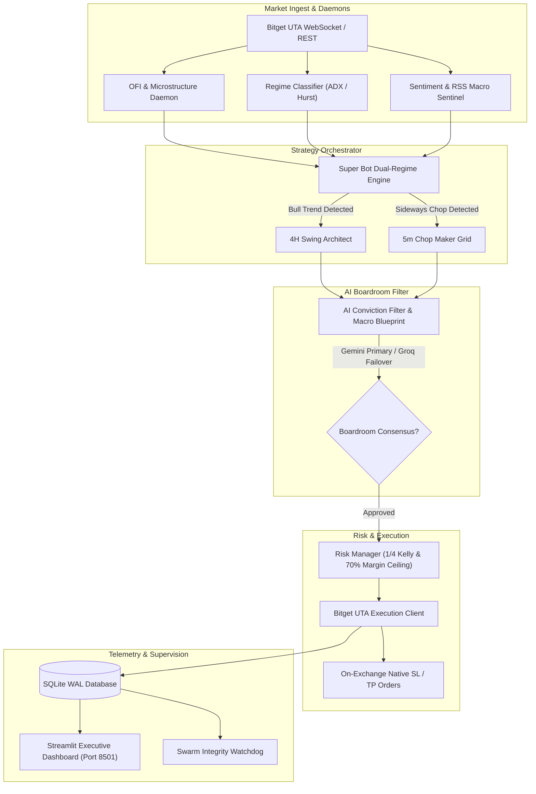

# 🦅 Autonomous Multi-Agent Crypto Trading Engine

[](https://www.python.org/)
[](https://opensource.org/licenses/MIT)
[](https://streamlit.io/)
[](https://www.bitget.com/)

A production-grade, multi-asset crypto futures trading system featuring a **Dual-Regime Execution Engine** (4H Trend Swing & 5m Chop Maker Grid), high-frequency **Order Flow Imbalance (OFI)** microstructure filtering, and an autonomous **Multi-Agent AI Risk Boardroom** with real-time LLM failover.

---

## ⚡ Key Highlights

- **Dual-Regime Execution Architecture**:
  - **4H Bull Trend Swing**: Trend-following breakout strategy using custom Ichimoku Kumo bands, volatility expansion, and dynamic trailing stop-loss ratchets.
  - **5m Chop Maker Grid**: Low-latency, post-only limit order grid designed to capture mean-reverting chop while earning maker fee rebates.
- **Microstructure & Order Flow Filtering (OFI)**:
  - Real-time Level-2 order book depth tracking, flow toxicity estimation (VPIN), and empirical position sizing via Quarter-Kelly criterion.
- **Multi-Agent AI Boardroom**:
  - Consensus filtering using primary LLM reasoning (Gemini Flash) with automatic zero-downtime failover to high-throughput secondary pools (Groq / Llama-3).
  - In-flight position monitoring, early structural invalidation, and automated post-mortem trade analysis.
- **Institutional Risk Controls**:
  - Global portfolio margin utilization ceiling (hard cap at 70%).
  - Hard stops placed directly on-exchange upon fill to prevent liquidation during network outages or loop stalls.
  - Strict high-water mark (HWM) drawdown circuit breakers.
- **Real-Time Streamlit HUD**:
  - Complete situational awareness dashboard showing live position execution cards, interactive Plotly candlestick charts, order flow depth meters, and token quota telemetry.

---

## 🏗️ System Architecture



---

## 📂 Repository Structure

```
├── super_bot.py                 # Dual-regime orchestrator (Swing + Chop Grid)
├── swing_trader.py              # 4H Ichimoku trend breakout engine
├── bitget_uta_client.py         # Direct REST/WebSocket exchange connector
├── conviction_filter.py         # Multi-agent AI boardroom & entry validator
├── ai_engine.py                 # LLM provider router (Gemini + Groq pool)
├── ofi_daemon.py                # Level-2 Order Flow Imbalance streamer
├── regime_classifier.py         # ADX / Hurst market regime classifier
├── risk_manager.py              # Empirical Kelly sizing & risk limits
├── portfolio_risk_agent.py      # Real-time portfolio margin ceiling daemon
├── macro_sentinel.py            # Funding rate skew & open interest monitor
├── sentinel_agent.py            # RSS & crypto disaster news auditor
├── economic_calendar.py         # High-impact macro event calendar gate
├── dashboard.py                 # Streamlit live telemetry dashboard
├── start_system.py              # Master supervisor daemon & process manager
└── config.py                    # Centralized parameters & trading constants
```

---

## 🚀 Quick Start

### 1. Prerequisites
- Python 3.11 or 3.12
- Git
- Bitget API credentials (UTA - Unified Trading Account with Futures permissions)

### 2. Installation
```bash
# Clone the repository
git clone https://github.com/Mrbadador/autonomous-crypto-trading-bot.git
cd autonomous-crypto-trading-bot

# Create and activate virtual environment
python -m venv .venv
source .venv/bin/activate   # On Windows: .venv\Scripts\activate

# Install dependencies
pip install -r requirements.txt
```

### 3. Environment Configuration
Copy the template and fill in your keys:
```bash
cp .env.example .env
```

Edit `.env`:
```ini
# Bitget UTA Exchange Credentials
BITGET_API_KEY=your_bitget_api_key
BITGET_SECRET_KEY=your_bitget_secret_key
BITGET_PASSPHRASE=your_bitget_passphrase

# AI Models (Optional for Boardroom Consensus)
GEMINI_API_KEY=your_gemini_api_key
GROQ_API_KEY=your_groq_api_key

# Risk Parameters
RISK_PER_TRADE_PCT=1.5
GLOBAL_MARGIN_LIMIT=0.70
```

### 4. Running the Swarm
To launch the entire fleet of background daemons, strategy engines, and the live dashboard:
```bash
python start_system.py
```

### 5. Accessing the Live Dashboard
Open your browser and navigate to:
```
http://localhost:8501
```

---

## 🛡️ Risk & Safety Notice

> **Important**: Cryptocurrency futures trading carries significant risk. This codebase is provided for research, backtesting, and algorithmic trading automation. Always run in paper-trading or small-capital test environments before deploying substantial capital. Ensure hard stops and margin limits are configured appropriately for your risk tolerance.

---

## 📜 License
Distributed under the MIT License. See `LICENSE` for more information.
